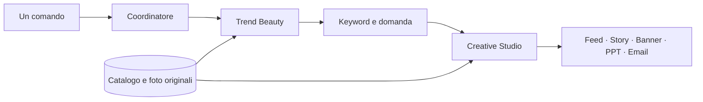

# IOMA — Beauty Radar

L’agente prepara **sei grafiche, due PowerPoint e due email coordinate**: francese e italiano,
ciascuno con feed, story, banner, presentazione editoriale di quattro slide e newsletter. La direzione attuale usa fotografia di prodotto originale,
logo centrato in alto, Cormorant Garamond per i titoli e una composizione
specifica per ciascun formato.

## Avvio

```sh
python -m pip install -r requirements.txt
python agent.py --product 'Sublime' --research research/brief-aggiornato.json
```

`brief-aggiornato.json` è il brief della settimana preparato e revisionato
secondo le regole sotto. Il file `research/2026-10-08.json` è un esempio
storico: dopo 36 ore non si può usarlo per una nuova campagna.

Ogni esecuzione crea una nuova cartella `output/ioma-<data>-<id>/`:

```text
fr/feed.png      1080×1350
fr/story.png     1080×1920
fr/banner.png    300×250
fr/presentazione.pptx    4 slide
fr/email.html           template responsive
fr/email.eml            bozza con immagini incorporate
fr/email-logo.png       logo originale per l’HTML
it/feed.png      1080×1350
it/story.png     1080×1920
it/banner.png    300×250
it/presentazione.pptx    4 slide
it/email.html           template responsive
it/email.eml            bozza con immagini incorporate
it/email-logo.png       logo originale per l’HTML
```

Solo francese e italiano. Caption, fonti, concept e controlli restano nel database
`data/catalog.sqlite`, tabella `generations`, campo `research_json`.

## Varietà delle creatività

Ogni campagna alterna automaticamente **prodotto singolo → modella → pack**.
Gli sfondi cambiano palette, forme architettoniche e campo di luce; il programma
confronta l’hash del fondale con tutto lo storico per non riutilizzarlo. Il seed
salvato permette di riprodurre il design. Sono composizioni grafiche generate
dal renderer; la foto editoriale della modella proviene dal manifest dedicato.

```sh
python agent.py --product 'Shampooing Soin Hydratant Anti-Casse' \
  --research research/brief-capelli-aggiornato.json --creative-mode auto
```

`--creative-mode product`, `model` o `pack` sceglie un tipo preciso. Il pack
affianca due o tre prodotti originali dello stesso ambito; con
`--creative-mode pack --pack-products apres-shampooing-reparateur` si sceglie
l’abbinamento per lo shampoo. Il prezzo di un eventuale cofanetto e gli effetti
combinati non vengono inventati. La modella è un ritratto generato, senza
attribuirle una recensione o un risultato del trattamento.

[Anteprime dei tre layout, in francese e italiano](designs/2026-10-22-variety/README.md).
Per produrre altre **anteprime tecniche**, senza nuova ricerca o pubblicazione:

```sh
python preview_creatives.py --output output/anteprime-nuove
```

La campagna completa richiede sempre ricerca attuale, revisione visiva e conferma
SÌ/NO. I brief per i capelli usano la categoria Google Trends **Hair Care (146)**;
le campagne viso/corpo mantengono **Face & Body Care (143)**.

## Catalogo IOMA e recensioni

Il catalogo contiene **63 articoli**, tutti quelli presenti nella sitemap
pubblica verificata il 22 ottobre 2026: prodotti, routine, cofanetti e altri
articoli del negozio. Sono incluse descrizioni francesi e italiane, dettagli,
composizione, foto originali, varianti, prezzi e **2.461 recensioni pubbliche**
con testo, voto, data e fonte. Ogni prodotto conserva media e numero di recensioni
dichiarati dal widget; i commenti restano opinioni dei clienti.

```sh
python catalog_sync.py
```

Il comando pagina il catalogo e il widget pubblico Judge.me, aggiorna
`assets/catalog/ioma.json` e il database. Lo snapshot viene applicato anche
alle copie esistenti del database, senza duplicare i tre prodotti originari
né cancellare campagne o stato Instagram. Le recensioni sono nella tabella
`product_reviews`; dati ufficiali e prezzi sono in `products.json_ld.official`.
Un errore di accesso alle recensioni viene indicato come parziale/non disponibile.

Sono pronti anche brief creativi ed email per **Shampooing Soin Hydratant Anti-Casse**
e **Après-Shampooing Réparateur**, scelto come secondo prodotto da abbinare.
Gli altri articoli sono consultabili nel database; prima di usarli per nuove
campagne occorre aggiungere copy e ingredienti revisionati. Il prezzo dello
shampoo rilevato sul sito è **24,90 €**; il riferimento fornito dall’utente di
**25,00 € per 200 ml** resta conservato separatamente.

## Tre agenti, un solo avvio

`agent.py` avvia `BeautyCoordinator`, che passa un brief strutturato tra
tre componenti Python specializzati, nello stesso progetto:

| Agente | Compito | Cosa passa al successivo |
| --- | --- | --- |
| **Trend Beauty** — `agents/trends.py` | Cerca notizie degli ultimi 7 giorni, ricontrolla il brief revisionato, distingue articoli/promozioni/campagne e seleziona il prodotto dal database. | `TrendBrief`: prodotto originale, claim di catalogo, fonti, tema e date. |
| **Keyword & Domanda** — `agents/keywords.py` | Interroga Google Trends per Francia e Italia; conserva TOP, RISING, date, valori e risposte originali. | `KeywordBrief`: dati per mercato e ipotesi di messaggio da verificare. |
| **Creative Studio** — `agents/assets.py` | Verifica gli ingredienti, unisce i due brief e prepara grafiche, PowerPoint ed email nelle due lingue. | Asset e `CampaignBrief`, registrati insieme nel database. |



Il terminale mostra quale agente è in corso, completato o fallito. Se uno
fallisce, i successivi non partono; un errore creativo annulla tutti i nuovi
export. I file precedenti rimangono disponibili. L’errore indica il nome
dell’agente e la causa; le evidenze non vengono sostituite con dati inventati.

Nel report SQLite, `agent_pipeline` registra i tre passaggi e i relativi
orari; `campaign_brief` documenta il prodotto, il claim, le foto, gli attivi,
il setting, i titoli e le keyword passate al creativo. I dati originali delle
ricerche restano in `weekly.google_trends_results`. Le keyword guidano la
lettura strategica del PowerPoint; i claim e i titoli pubblici rimangono
quelli verificati per il prodotto. Non si inserisce automaticamente una
query popolare nel claim.

Le classi hanno un metodo `run` e si possono sostituire indipendentemente
nel coordinatore, per esempio durante un test o un’integrazione futura.
Non occorrono tre server, tre database o nuove dipendenze. Sono componenti
Python con regole editoriali e provider reali di ricerca, senza un modello
linguistico collegato in questa versione. Questa separazione **non elimina**
la revisione del brief entro 36 ore, la verifica degli ingredienti per ogni
prodotto o il controllo visivo finale. Veo, invio email e gestione del budget
richiedono ancora integrazioni dedicate.

## Pubblicare su Instagram

`agents/publisher.py` aggiunge la pubblicazione di un feed già revisionato,
con la sua caption, tramite l’API ufficiale Instagram Login. Il post francese
del contorno occhi è stato [pubblicato su @gb77ita](https://www.instagram.com/p/DexcJYEgdJL/)
il 22 ottobre 2026 (Europe/Paris), dopo il SÌ dell’utente. Il collegamento reale al
profilo Creator e la lettura della quota API sono stati verificati il 21 ottobre
2026 con il segreto `INSTAGRAM_ACCESS_TOKEN`; il token deve restare valido.

```sh
python -m agents.publisher connect --username gb77ita
```

Il modulo verifica il profilo, prepara un JPEG dal PNG originale e registra
l’esito in SQLite per evitare invii duplicati. Ogni nuova generazione registra
la domanda di pubblicazione per ciascuna lingua. Nella chat, dopo revisione
visiva e preparazione dell’URL pubblico, l’agente mostra il feed e la caption
e chiede **«Vuoi pubblicarlo su Instagram? SÌ/NO»**. Se rispondi SÌ pubblica;
se rispondi NO resta in bozza. La conferma vale solo per il contenuto mostrato.

`offer` salva la domanda; `respond --request ID --answer SI` esegue la risposta
dell’utente. `publish` chiede conferma nel terminale; senza terminale interattivo
salva la domanda in attesa di risposta. `check` controlla senza pubblicare.
Il renderer da solo lascia la revisione visiva in attesa: il flusso in chat
la completa prima di chiedere il consenso. Feed francese e italiano hanno
conferme distinte; story e banner non sono supportati da questo publisher.

[Collegamento Meta e comandi del post francese](INSTAGRAM.md).

## Eseguire soltanto l’agente keyword

Dalla cartella del progetto, dopo avere preparato il brief aggiornato:

```sh
python -m agents.keywords --research research/brief-aggiornato.json
```

Il comando verifica il brief, legge il prodotto dal catalogo e interroga
Google Trends per Francia e Italia. Mostra le query TOP e RISING nel
terminale e salva dati, date, link e risposte originali in un nuovo file
`output/keywords/keywords-<data>-<id>.json`. Non avvia Trend Beauty o
Creative Studio, non crea asset e non aggiunge una campagna allo storico.
La verifica delle pagine del brief resta necessaria; non viene rifatta la
ricerca RSS. `--database` seleziona un catalogo diverso e
`--output risultati/keyword` cambia la cartella dei report.

La selezione delle query nel brief deve essere pertinente alla settimana
corrente. L’esempio dell’8 ottobre rimane storico: non cambiarne soltanto
la data. Un errore di accesso, un brief scaduto o dati insufficienti
terminano il comando con stato 1 senza creare un nuovo report.

## Email coordinata

Dopo gli asset, `newsletter.py` crea un’email per ogni lingua. Riutilizza
**esattamente il PNG del feed**: niente rigenerazione, ritaglio o ricompressione.
Il layout segue le email IOMA fornite: logo centrale, immagine protagonista,
testo breve centrato e un solo pulsante scuro. L’immagine conserva i propri
colori e la propria tipografia; i testi dell’email usano titoli serif e corpo
leggibile, con margini generosi.

Gli oggetti usano curiosità e benefici documentati, senza recensioni,
scarsità, sconti o risultati clinici inventati. Il testo commerciale ha
cinque frasi brevi: apertura curiosa, tre benefici documentati e una chiusura
che spiega per quali esigenze il prodotto è adatto. I benefici sono su righe
distinte, con a capo naturali su mobile. Massimo 55 caratteri per
l’oggetto, 100 per il preheader e 70 parole commerciali. Alla successiva
campagna dello stesso prodotto l’oggetto cambia. I testi in
`assets/email/product-copy.json` derivano dai benefici del catalogo:
gli esempi inoltrati guidano lo stile, non aggiungono claim ad altri prodotti.
Se cambia il claim di catalogo, anche il brief email deve essere aggiornato.

`email.eml` è una **bozza non inviata**: mittente IOMA, destinatario vuoto,
oggetto, testo semplice e HTML. Feed e logo sono incorporati via CID con i
byte originali; si apre offline. Di default la disiscrizione è una richiesta
via email a `contact@ioma-paris.com`. Non avviene alcun invio automatico.

`email.html` contiene il preheader nascosto e l’oggetto nel titolo HTML.
Usa tabelle e stili inline, immagini fluide, media query per mobile e
pulsante VML per Outlook. Le immagini sono relative nella versione locale;
per importarlo in Klaviyo, indicare una base HTTPS con gli asset pubblicati:

```sh
python agent.py --product 'Sublime' --research research/brief-aggiornato.json \
  --email-assets-url 'https://cdn.example.com/campagna' \
  --email-subject-fr 'Et si votre routine devenait sublime ?' \
  --email-subject-it 'E se il tuo rituale diventasse sublime?'
```

Per ogni lingua il template punta a `<base>/fr/feed.png` e
`<base>/fr/email-logo.png` oppure agli equivalenti `it/`. Klaviyo risolve
`` per ogni destinatario; con
`--email-unsubscribe-url 'https://example.com/preferenze'` si può indicare
il link del proprio sistema di invio. I link prodotto includono parametri
UTM. Gli indirizzi personalizzati e i link di tracking degli esempi inoltrati
non vengono copiati nel progetto.

Oggetto, preheader, testo, percorsi e hash del feed vengono salvati in
`research_json.localizations.<lingua>.email`. Se un’email fallisce, tutta
la nuova campagna viene annullata insieme alle grafiche e ai PowerPoint.
La verifica di esportazione e della resa locale non equivale a una prova
di consegna o di rendering in tutti i client di posta.

## Direzione artistica e copy

`editorial.py` e `assets/catalog/creative-briefs.json` contengono brief bilingui
per i tre prodotti originali e i due nuovi prodotti per capelli. Per
Crème Sublime la direzione mette al centro nutrimento e compattezza. I titoli
sono specifici del beneficio, non frasi generiche sul rituale. Le traduzioni
sono scritte per ciascuna lingua; nome del prodotto e packaging restano quelli
ufficiali. Un nuovo prodotto o un claim cambiato richiedono l’aggiornamento del
brief: il programma termina se il catalogo non corrisponde.

`studio.py` compone i tre formati alla dimensione finale. Non ritaglia un feed
per ricavarne il banner e non allunga le immagini per ottenere la story.
Il prodotto viene ridimensionato dalla foto originale per ogni formato, con
ombre di contatto e diffuse separate. Feed e story non contengono pulsanti;
il banner ha una CTA testuale discreta. I titoli non vengono rimpiccioliti
silenziosamente se non entrano: occorre rivedere il copy.

I fondali fotografici storici sono in `assets/backgrounds/editorial/`, con
provenienza e hash in `editorial-scenes.json`. Le nuove campagne usano le palette
e le forme variabili di `art_direction.py`, con spazio per i testi e un piano
continuo sotto i prodotti. `variety_studio.py` compone ritratto e pack nei tre
formati. Anche le varianti di titolo alternano tra le esecuzioni. Ogni nuova
composizione richiede comunque un controllo visivo.

L’ombra proiettata segue la sagoma reale del packshot e la luce del fondale;
diventa più morbida e meno densa lontano dalla base. L’ombra di contatto segue
la larghezza della base, senza margini trasparenti che facciano galleggiare il
flacone. Il layout usa più altezza per i flaconi sottili. Oltre al contrasto,
l’agente verifica che non ci siano dettagli eccessivi dietro ai testi; controlli
e parametri dell’ombra vengono salvati nel report. La revisione visiva resta
obbligatoria: nessun controllo numerico certifica da solo una resa perfetta.

I font sono inclusi con licenza in `assets/fonts/`. La foto del prodotto,
la sua etichetta e il marchio non vengono rigenerati dall’IA.

## PowerPoint e ingredienti

`radar_presentation.py` crea una presentazione 16:9 sobria, con logo IOMA
centrato, fondo avorio, titoli redazionali, testi modificabili e fonti cliccabili:

1. Skincare della settimana, ingredienti e marche con attività pubblicitaria
   documentata. Articoli editoriali, promozioni e campagne restano distinti.
2. Prodotto IOMA, collegamento con i segnali osservati, pubblico ipotizzato,
   proposta di attivazione social e confronto misurabile tra due messaggi.
3. Ricerche Google della settimana: Francia nel file francese, Italia in quello
   italiano, con query principali e query in crescita in due colonne separate.
4. Articoli e fonti: titolo, testata, data e link «Leggi l’articolo»; i comunicati
   dei marchi sono identificati separatamente.

Le fonti complete e la caption sono anche nelle note. Per mantenere i font
modificabili identici su un altro computer, installare Cormorant Garamond e
DejaVu Sans da `assets/fonts/` (licenze incluse).

`weekly.py` legge il brief datato indicato con `--research`: la ricerca deve
essere stata revisionata nelle ultime 36 ore. **Un nuovo avvio richiede di
aggiornare il brief con fonti realmente lette, non soltanto la data.** Il
programma ricontrolla le pagine e i termini documentati, rifiuta notizie future
o scadute e richiede una campagna pubblicitaria distinta dalle promozioni.
Una campagna raccontata prima della settimana può apparire se la finestra
pubblicata risulta ancora attiva, dichiarando la data dell’articolo. Non è
una verifica di erogazione paid o spesa pubblicitaria.

I due richiami con freccia nei PNG con prodotto singolo provengono dall’INCI ufficiale e dai temi
presenti nelle fonti recenti. L’agente si ferma se non trova due corrispondenze.
La priorità è editoriale, non un’affermazione sulla concentrazione in formula.
Il registro corrente copre Crème Sublime (ceramidi e peptide RIGIN™) e
Crème Généreuse Contour des Yeux (peptidi e vitamina E), verificati nelle
rispettive schede IOMA. Copre anche lo shampoo (girasole e Pentavitin®) e il
balsamo riparatore (argan e cocco). Il lettore delle formule per capelli usa
la sezione composizione, conservando anche gli ingredienti dopo PARFUM;
non prende ingredienti dalle recensioni. Nei layout modella/pack gli attivi
restano nel brief e nel PowerPoint, senza frecce sui volti o sugli altri prodotti.
Gli altri prodotti
richiedono un registro ingredienti e un brief verificati prima di usare il flusso.

Campagna contorno occhi del 17 ottobre 2026:

```sh
python agent.py --product 'Généreuse' --research research/2026-10-17-contour-yeux.json
```

Questo brief fotografa le fonti lette il 17 ottobre: dopo 36 ore va aggiornato
insieme al pool Google Trends. Le query possono variare anche nella stessa
giornata; il messaggio di errore ora indica mercato e numero di corrispondenze.
La presentazione usa titoli strategici specifici del prodotto e distingue il
blog di un marchio da una campagna pubblicitaria documentata.

## Google Trends

`google_trends.py` interroga Google Trends a ogni esecuzione. Usa gli ultimi
sette giorni UTC completati (esclude la giornata in corso), ricerca Web,
categoria Google 143 «Face & Body Care» oppure 146 «Hair Care» per i capelli,
senza keyword iniziale. La terza
slide indica il perimetro, la settimana e un link diretto ai dati.

Il pool di query revisionate nel brief mantiene solo termini pertinenti al
beauty: conserva
ortografia, ordine e valori originali, senza accorpare singolari/plurali o
rinormalizzare i punteggi. Gli indici TOP 0–100 sono relativi al mercato;
le percentuali RISING confrontano i sette giorni precedenti. Non sono volumi
assoluti e i punteggi di Francia e Italia non si confrontano direttamente.

Le risposte originali sono nelle note delle slide e nel report SQLite. Gli
snapshot verificati di questa revisione sono in `research/google-trends/`.
Niente classifiche inventate: errori di accesso, dati scaduti, scope diverso
o meno di cinque query TOP / tre RISING pertinenti bloccano la generazione.
La selezione usa solo query presenti nel campione corrente. Quando il
brief viene aggiornato, rivedere anche le selezioni nei dati della settimana.

## Ricerca e qualità

A ogni avvio si cerca nuovamente nelle notizie degli ultimi sette giorni.
I titoli sono segnali editoriali per scegliere il prodotto, non misure di
popolarità: la caption non li presenta come trend dimostrati. I benefici
pubblici provengono dai brief e dal catalogo. Per il contenuto di Crème Sublime
è stata consultata la [scheda ufficiale IOMA](https://ioma-paris.com/products/creme-sublime-revitalisante).

I controlli automatici verificano dimensioni, contrasto, sovrapposizioni,
logo centrato, margini, safe zone della story, coerenza dei claim e integrità
dei file. Un errore in una lingua annulla l'intero nuovo pacchetto, senza
toccare i file precedenti.

**I controlli tecnici non certificano la qualità pubblicitaria.** Il flusso
assistito descritto in `AGENTS.md` richiede di aprire tutti i PNG e verificarli
anche a dimensione smartphone; eventuali difetti vengono corretti prima della
consegna. Anche le otto slide vengono aperte e controllate dopo il rendering.
Il programma registra inizialmente `visual_review: pending`.
La revisione annota osservazioni e hash dei file esaminati. Non esiste una
pubblicazione automatica sui social.

```sh
python -m pip install -r requirements-dev.txt
python -m unittest discover -s tests -v
```

`campaign.py`, `creative.py`, `localization.py` e `presentation.py` mantengono
funzioni storiche per riprodurre le campagne archiviate. Il punto di ingresso
attuale `agent.py` usa `coordinator.py` e i tre componenti in `agents/`,
che riutilizzano `editorial.py`, `studio.py`, `weekly.py` e `radar_presentation.py`; nessun export storico viene
aggiunto alle nuove consegne.
