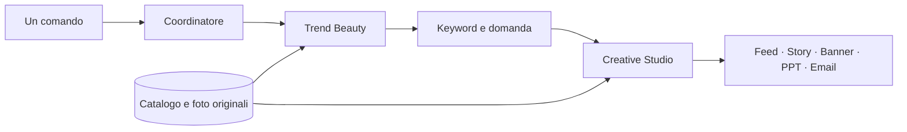

# IOMA — Beauty Radar

L’agente prepara **sei grafiche, due PowerPoint e due email coordinate**: francese e italiano,
ciascuno con feed, story, banner, presentazione editoriale di quattro slide e newsletter. La direzione attuale usa fotografia di prodotto originale,
logo centrato in alto, Cormorant Garamond per i titoli e una composizione
specifica per ciascun formato.

Ogni richiesta creativa include sempre **post + email + story**, anche quando
si chiede soltanto «un post Instagram». Nel flusso Codex, l’email italiana viene
inviata tramite **Gmail a gb77ita@gmail.com**: un invio per campagna, con conferma
registrata. Le due versioni linguistiche rimangono disponibili come file.
La story viene creata; la sua pubblicazione richiede una richiesta specifica.

## Avvio

```sh
python -m pip install -r requirements.txt
python agent.py --product 'Sublime' --research research/brief-aggiornato.json
```

`brief-aggiornato.json` è il brief della settimana preparato e revisionato
secondo le regole sotto. Il file `research/2026-10-08.json` è un esempio
storico: dopo 36 ore non si può usarlo per una nuova campagna.

Ogni esecuzione crea una nuova cartella `output/ioma-<data>-<id>/`:

```text
fr/feed.png      1080×1350
fr/caption.txt   testo e hashtag del post
fr/story.png     1080×1920
fr/banner.png    300×250
fr/presentazione.pptx    4 slide
fr/email.html           template responsive
fr/email.eml            bozza con immagini incorporate
fr/email-logo.png       logo originale per l’HTML
it/feed.png      1080×1350
it/caption.txt   testo e hashtag del post
it/story.png     1080×1920
it/banner.png    300×250
it/presentazione.pptx    4 slide
it/email.html           template responsive
it/email.eml            bozza con immagini incorporate
it/email-logo.png       logo originale per l’HTML
delivery.json           completezza del pacchetto e stato reale dell’invio Gmail
```

Solo francese e italiano. Caption, fonti, concept e controlli restano anche nel database
`data/catalog.sqlite`, tabella `generations`, campo `research_json`.

## Tre agenti, un solo avvio

`agent.py` avvia `BeautyCoordinator`, che passa un brief strutturato tra
tre componenti Python specializzati, nello stesso progetto:

| Agente | Compito | Cosa passa al successivo |
| --- | --- | --- |
| **Trend Beauty** — `agents/trends.py` | Cerca notizie degli ultimi 7 giorni, ricontrolla il brief revisionato, distingue articoli/promozioni/campagne e seleziona il prodotto dal database. | `TrendBrief`: prodotto originale, claim di catalogo, fonti, tema e date. |
| **Keyword & Domanda** — `agents/keywords.py` | Interroga Google Trends per Francia e Italia; conserva TOP, RISING, date, valori e risposte originali. | `KeywordBrief`: dati per mercato e ipotesi di messaggio da verificare. |
| **Creative Studio** — `agents/assets.py` | Verifica gli ingredienti, unisce i due brief e prepara grafiche, PowerPoint ed email nelle due lingue. | Asset e `CampaignBrief`, registrati insieme nel database. |



Il terminale mostra quale agente è in corso, completato o fallito. Se uno
fallisce, i successivi non partono; un errore creativo annulla tutti i nuovi
export. I file precedenti rimangono disponibili. L’errore indica il nome
dell’agente e la causa; le evidenze non vengono sostituite con dati inventati.

Nel report SQLite, `agent_pipeline` registra i tre passaggi e i relativi
orari; `campaign_brief` documenta il prodotto, il claim, le foto, gli attivi,
il setting, i titoli e le keyword passate al creativo. I dati originali delle
ricerche restano in `weekly.google_trends_results`. Le keyword guidano la
lettura strategica del PowerPoint; i claim e i titoli pubblici rimangono
quelli verificati per il prodotto. Non si inserisce automaticamente una
query popolare nel claim.

Le classi hanno un metodo `run` e si possono sostituire indipendentemente
nel coordinatore, per esempio durante un test o un’integrazione futura.
Non occorrono tre server, tre database o nuove dipendenze. Sono componenti
Python con regole editoriali e provider reali di ricerca, senza un modello
linguistico collegato in questa versione. Questa separazione **non elimina**
la revisione del brief entro 36 ore, la verifica degli ingredienti per ogni
prodotto o il controllo visivo finale. L’invio usa il connettore Gmail nel flusso
Codex descritto sotto. Veo, pubblicazione Meta nel CLI e gestione del budget
richiedono ancora integrazioni dedicate.

## Consegna completa tramite Gmail in Codex

`delivery-policy.json` conserva il destinatario autorizzato, il provider Gmail
e la lingua italiana dell’email da inviare. Il generatore rifiuta una campagna
senza post/caption, story o email; verifica i formati e i byte del feed incorporato.
Il registro `delivery.json` distingue la creazione degli asset dall’invio reale.

Dopo la revisione visiva e la pubblicazione degli asset su GitHub:

```sh
python delivery.py prepare --campaign output/ioma-<id> \
  --assets-url 'https://raw.githubusercontent.com/gbetti/AGENT_BEAUTY/<commit>/posts/<campagna>'
python delivery.py begin-send --campaign output/ioma-<id>
```

Codex passa il JSON restituito al tool Gmail `send_email`, già collegato,
e salva la ricevuta reale (`id`, `thread_id`, `label_ids`, inclusa `SENT`):

```sh
python delivery.py record-sent --campaign output/ioma-<id> \
  --receipt /tmp/gmail-receipt.json --database data/catalog.sqlite
```

Il messaggio parte dall’account Gmail autenticato. Le immagini pubbliche vengono
confrontate con i PNG locali prima dell’invio. Il contenuto resta quello della
newsletter coordinata; nessuna spedizione a liste clienti viene configurata.

Il CLI Python **da solo non può chiamare i connettori Codex**: termina con codice
2 quando gli asset sono pronti ma l’invio resta da completare. Per una richiesta
esplicita di sola generazione usare `--prepare-only`, che termina con codice 0 e
mantiene `pending_email`. Il flusso completo in Codex segue `AGENTS.md` e termina
soltanto dopo la conferma Gmail. Il comando keyword rimane una ricerca senza invii.
Un invio interrotto o già completato non viene ripetuto automaticamente: bisogna
riconciliare il tentativo in Gmail. I file restano disponibili anche se Gmail fallisce.

## Eseguire soltanto l’agente keyword

Dalla cartella del progetto, dopo avere preparato il brief aggiornato:

```sh
python -m agents.keywords --research research/brief-aggiornato.json
```

Il comando verifica il brief, legge il prodotto dal catalogo e interroga
Google Trends per Francia e Italia. Mostra le query TOP e RISING nel
terminale e salva dati, date, link e risposte originali in un nuovo file
`output/keywords/keywords-<data>-<id>.json`. Non avvia Trend Beauty o
Creative Studio, non crea asset e non aggiunge una campagna allo storico.
La verifica delle pagine del brief resta necessaria; non viene rifatta la
ricerca RSS. `--database` seleziona un catalogo diverso e
`--output risultati/keyword` cambia la cartella dei report.

La selezione delle query nel brief deve essere pertinente alla settimana
corrente. L’esempio dell’8 ottobre rimane storico: non cambiarne soltanto
la data. Un errore di accesso, un brief scaduto o dati insufficienti
terminano il comando con stato 1 senza creare un nuovo report.

## Email coordinata

Dopo gli asset, `newsletter.py` crea un’email per ogni lingua. Riutilizza
**esattamente il PNG del feed**: niente rigenerazione, ritaglio o ricompressione.
Il layout segue le email IOMA fornite: logo centrale, immagine protagonista,
testo breve centrato e un solo pulsante scuro. L’immagine conserva i propri
colori e la propria tipografia; i testi dell’email usano titoli serif e corpo
leggibile, con margini generosi.

Gli oggetti usano curiosità e benefici documentati, senza recensioni,
scarsità, sconti o risultati clinici inventati. Il testo commerciale ha
cinque frasi brevi: apertura curiosa, tre benefici documentati e una chiusura
che spiega per quali esigenze il prodotto è adatto. I benefici sono su righe
distinte, con a capo naturali su mobile. Massimo 55 caratteri per
l’oggetto, 100 per il preheader e 70 parole commerciali. Alla successiva
campagna dello stesso prodotto l’oggetto cambia. I testi in
`assets/email/product-copy.json` derivano dai benefici del catalogo:
gli esempi inoltrati guidano lo stile, non aggiungono claim ad altri prodotti.
Se cambia il claim di catalogo, anche il brief email deve essere aggiornato.

`email.eml` conserva la **bozza sorgente**: mittente IOMA, destinatario vuoto,
oggetto, testo semplice e HTML. Feed e logo sono incorporati via CID con i
byte originali; si apre offline. Di default la disiscrizione è una richiesta
via email a `contact@ioma-paris.com`. L’invio coordinato avviene con il connettore
Gmail e viene registrato separatamente in `delivery.json`, senza modificare l’EML.

`email.html` contiene il preheader nascosto e l’oggetto nel titolo HTML.
Usa tabelle e stili inline, immagini fluide, media query per mobile e
pulsante VML per Outlook. Le immagini sono relative nella versione locale;
per importarlo in Klaviyo, indicare una base HTTPS con gli asset pubblicati:

```sh
python agent.py --product 'Sublime' --research research/brief-aggiornato.json \
  --email-assets-url 'https://cdn.example.com/campagna' \
  --email-subject-fr 'Et si votre routine devenait sublime ?' \
  --email-subject-it 'E se il tuo rituale diventasse sublime?'
```

Per ogni lingua il template punta a `<base>/fr/feed.png` e
`<base>/fr/email-logo.png` oppure agli equivalenti `it/`. Klaviyo risolve
`` per ogni destinatario; con
`--email-unsubscribe-url 'https://example.com/preferenze'` si può indicare
il link del proprio sistema di invio. I link prodotto includono parametri
UTM. Gli indirizzi personalizzati e i link di tracking degli esempi inoltrati
non vengono copiati nel progetto.

Oggetto, preheader, testo, percorsi e hash del feed vengono salvati in
`research_json.localizations.<lingua>.email`. Se un’email fallisce, tutta
la nuova campagna viene annullata insieme alle grafiche e ai PowerPoint.
La verifica di esportazione e della resa locale non equivale a una prova
di consegna o di rendering in tutti i client di posta.

## Direzione artistica e copy

`editorial.py` contiene brief bilingui per i tre prodotti del catalogo. Per
Crème Sublime la direzione mette al centro nutrimento e compattezza. I titoli
sono specifici del beneficio, non frasi generiche sul rituale. Le traduzioni
sono scritte per ciascuna lingua; nome del prodotto e packaging restano quelli
ufficiali. Un nuovo prodotto o un claim cambiato richiedono l’aggiornamento del
brief: il programma termina se il catalogo non corrisponde.

`studio.py` compone i tre formati alla dimensione finale. Non ritaglia un feed
per ricavarne il banner e non allunga le immagini per ottenere la story.
Il prodotto viene ridimensionato dalla foto originale per ogni formato, con
ombre di contatto e diffuse separate. Feed e story non contengono pulsanti;
il banner ha una CTA testuale discreta. I titoli non vengono rimpiccioliti
silenziosamente se non entrano: occorre rivedere il copy.

I fondali fotografici sono in `assets/backgrounds/editorial/`, con provenienza
e hash in `editorial-scenes.json`. Le nuove scene `studio-ivory` e `studio-pearl`
riservano aree uniformi a logo, titolo e ingredienti. Il piano di appoggio resta
visibile nei tre formati grazie a ritagli e coordinate documentati nel manifest.
Le scene storiche di seta rimangono disponibili per riprodurre gli archivi.
I nuovi fondali vengono alternati senza ripetere l’ultima scena;
anche le due varianti di titolo del prodotto alternano tra le esecuzioni.
Nuove ambientazioni vanno aggiunte soltanto dopo un controllo visivo nei tre formati.

L’ombra proiettata segue la sagoma reale del packshot e la luce del fondale;
diventa più morbida e meno densa lontano dalla base. L’ombra di contatto segue
la larghezza della base, senza margini trasparenti che facciano galleggiare il
flacone. Il layout usa più altezza per i flaconi sottili. Oltre al contrasto,
l’agente verifica che non ci siano dettagli eccessivi dietro ai testi; controlli
e parametri dell’ombra vengono salvati nel report. La revisione visiva resta
obbligatoria: nessun controllo numerico certifica da solo una resa perfetta.

I font sono inclusi con licenza in `assets/fonts/`. La foto del prodotto,
la sua etichetta e il marchio non vengono rigenerati dall’IA.

## PowerPoint e ingredienti

`radar_presentation.py` crea una presentazione 16:9 sobria, con logo IOMA
centrato, fondo avorio, titoli redazionali, testi modificabili e fonti cliccabili:

1. Skincare della settimana, ingredienti e marche con attività pubblicitaria
   documentata. Articoli editoriali, promozioni e campagne restano distinti.
2. Prodotto IOMA, collegamento con i segnali osservati, pubblico ipotizzato,
   proposta di attivazione social e confronto misurabile tra due messaggi.
3. Ricerche Google della settimana: Francia nel file francese, Italia in quello
   italiano, con query principali e query in crescita in due colonne separate.
4. Articoli e fonti: titolo, testata, data e link «Leggi l’articolo»; i comunicati
   dei marchi sono identificati separatamente.

Le fonti complete e la caption sono anche nelle note. Per mantenere i font
modificabili identici su un altro computer, installare Cormorant Garamond e
DejaVu Sans da `assets/fonts/` (licenze incluse).

`weekly.py` legge il brief datato indicato con `--research`: la ricerca deve
essere stata revisionata nelle ultime 36 ore. **Un nuovo avvio richiede di
aggiornare il brief con fonti realmente lette, non soltanto la data.** Il
programma ricontrolla le pagine e i termini documentati, rifiuta notizie future
o scadute e richiede una campagna pubblicitaria distinta dalle promozioni.
Una campagna raccontata prima della settimana può apparire se la finestra
pubblicata risulta ancora attiva, dichiarando la data dell’articolo. Non è
una verifica di erogazione paid o spesa pubblicitaria.

I due richiami con freccia nei PNG provengono dall’INCI ufficiale e dai temi
presenti nelle fonti recenti. L’agente si ferma se non trova due corrispondenze.
La priorità è editoriale, non un’affermazione sulla concentrazione in formula.
Il registro corrente copre Crème Sublime (ceramidi e peptide RIGIN™) e
Crème Généreuse Contour des Yeux (peptidi e vitamina E), verificati nelle
rispettive schede IOMA. Il lettore INCI riconosce anche le formule senza
PARFUM finale e non prende ingredienti dalle recensioni. Gli altri prodotti
richiedono un registro ingredienti e un brief verificati prima di usare il flusso.

Campagna contorno occhi del 17 ottobre 2026:

```sh
python agent.py --product 'Généreuse' --research research/2026-10-17-contour-yeux.json
```

Questo brief fotografa le fonti lette il 17 ottobre: dopo 36 ore va aggiornato
insieme al pool Google Trends. Le query possono variare anche nella stessa
giornata; il messaggio di errore ora indica mercato e numero di corrispondenze.
La presentazione usa titoli strategici specifici del prodotto e distingue il
blog di un marchio da una campagna pubblicitaria documentata.

## Google Trends

`google_trends.py` interroga Google Trends a ogni esecuzione. Usa gli ultimi
sette giorni UTC completati (esclude la giornata in corso), ricerca Web,
categoria Google 143 «Face & Body Care», senza keyword iniziale. La terza
slide indica il perimetro, la settimana e un link diretto ai dati.

Il pool di query revisionate nel brief mantiene solo termini pertinenti al
beauty: conserva
ortografia, ordine e valori originali, senza accorpare singolari/plurali o
rinormalizzare i punteggi. Gli indici TOP 0–100 sono relativi al mercato;
le percentuali RISING confrontano i sette giorni precedenti. Non sono volumi
assoluti e i punteggi di Francia e Italia non si confrontano direttamente.

Le risposte originali sono nelle note delle slide e nel report SQLite. Gli
snapshot verificati di questa revisione sono in `research/google-trends/`.
Niente classifiche inventate: errori di accesso, dati scaduti, scope diverso
o meno di cinque query TOP / tre RISING pertinenti bloccano la generazione.
La selezione usa solo query presenti nel campione corrente. Quando il
brief viene aggiornato, rivedere anche le selezioni nei dati della settimana.

## Ricerca e qualità

A ogni avvio si cerca nuovamente nelle notizie degli ultimi sette giorni.
I titoli sono segnali editoriali per scegliere il prodotto, non misure di
popolarità: la caption non li presenta come trend dimostrati. I benefici
pubblici provengono dai brief e dal catalogo. Per il contenuto di Crème Sublime
è stata consultata la [scheda ufficiale IOMA](https://ioma-paris.com/products/creme-sublime-revitalisante).

I controlli automatici verificano dimensioni, contrasto, sovrapposizioni,
logo centrato, margini, safe zone della story, coerenza dei claim e integrità
dei file. Un errore in una lingua annulla l'intero nuovo pacchetto, senza
toccare i file precedenti.

**I controlli tecnici non certificano la qualità pubblicitaria.** Il flusso
assistito descritto in `AGENTS.md` richiede di aprire tutti i PNG e verificarli
anche a dimensione smartphone; eventuali difetti vengono corretti prima della
consegna. Anche le otto slide vengono aperte e controllate dopo il rendering.
Il programma registra inizialmente `visual_review: pending`.
La revisione annota osservazioni e hash dei file esaminati. Non esiste una
pubblicazione automatica sui social.

```sh
python -m pip install -r requirements-dev.txt
python -m unittest discover -s tests -v
```

`campaign.py`, `creative.py`, `localization.py` e `presentation.py` mantengono
funzioni storiche per riprodurre le campagne archiviate. Il punto di ingresso
attuale `agent.py` usa `coordinator.py` e i tre componenti in `agents/`,
che riutilizzano `editorial.py`, `studio.py`, `weekly.py` e `radar_presentation.py`; nessun export storico viene
aggiunto alle nuove consegne.
