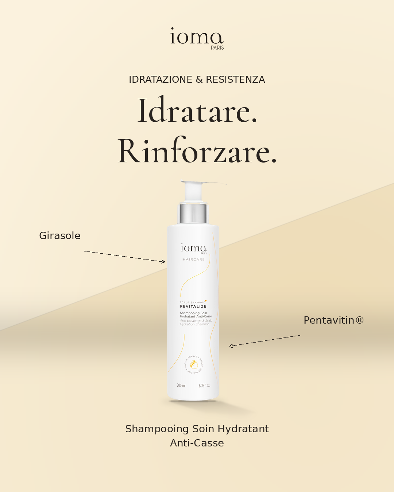
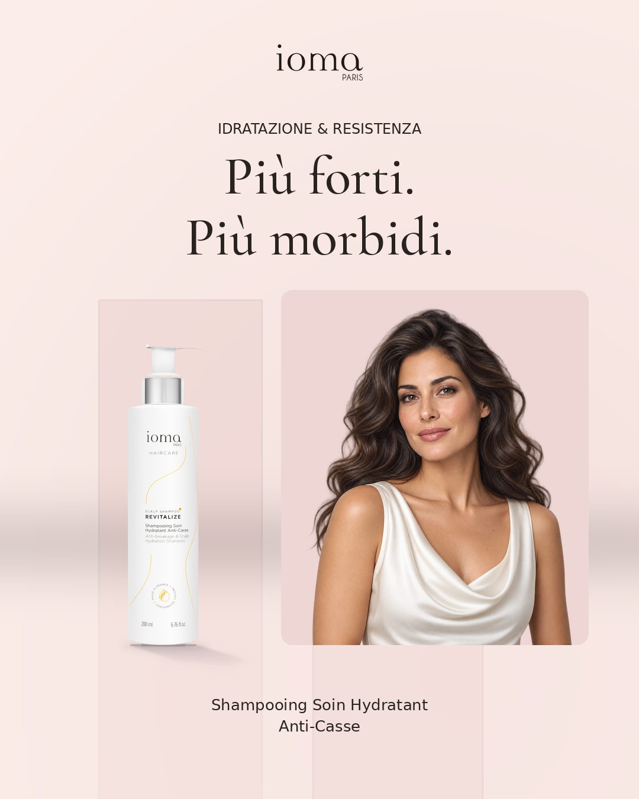
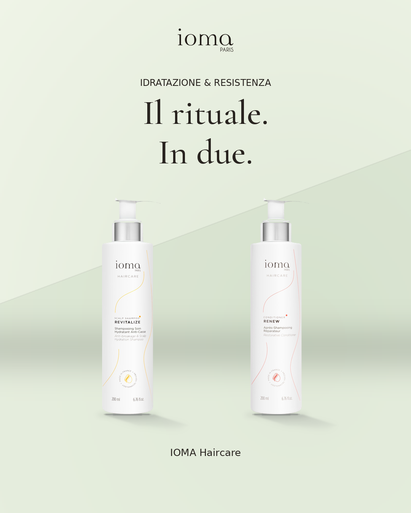

# Tre direzioni creative

Anteprime tecniche del 22 ottobre 2026: prodotto singolo, ritratto editoriale e
pack di prodotti. Francese e italiano, con feed 1080×1350, story 1080×1920 e
banner 300×250 per ogni direzione: **18 PNG controllati visivamente**.

Queste anteprime mostrano il nuovo renderer. Non sono una nuova campagna con
ricerca settimanale: nessuna è stata proposta o inviata a Instagram. La normale
campagna conserva ricerca, revisione, caption e conferma SÌ/NO.

| Prodotto singolo | Modella | Pack |
| --- | --- | --- |
|  |  |  |

| Direzione | Feed FR | Feed IT | Story FR | Story IT | Banner FR | Banner IT |
| --- | --- | --- | --- | --- | --- | --- |
| Prodotto | [PNG](product/fr/feed.png) | [PNG](product/it/feed.png) | [PNG](product/fr/story.png) | [PNG](product/it/story.png) | [PNG](product/fr/banner.png) | [PNG](product/it/banner.png) |
| Modella | [PNG](model/fr/feed.png) | [PNG](model/it/feed.png) | [PNG](model/fr/story.png) | [PNG](model/it/story.png) | [PNG](model/fr/banner.png) | [PNG](model/it/banner.png) |
| Pack | [PNG](pack/fr/feed.png) | [PNG](pack/it/feed.png) | [PNG](pack/fr/story.png) | [PNG](pack/it/story.png) | [PNG](pack/fr/banner.png) | [PNG](pack/it/banner.png) |

I flaconi sono foto ufficiali IOMA conservate nel catalogo. Il ritratto è una
modella adulta immaginaria generata per uso editoriale, senza testimonianze o
risultati attribuiti. Il pack abbina Shampooing Soin Hydratant Anti-Casse e
Après-Shampooing Réparateur; non rappresenta un’offerta commerciale o un prezzo
di cofanetto.

I file `design.json` conservano palette, motivi, seed, provenienza delle immagini,
caption dimostrative e hash dei PNG revisionati. Le palette e la geometria degli
sfondi cambiano nelle prossime campagne; il sistema conserva la rotazione delle
tre direzioni nello storico del database.
