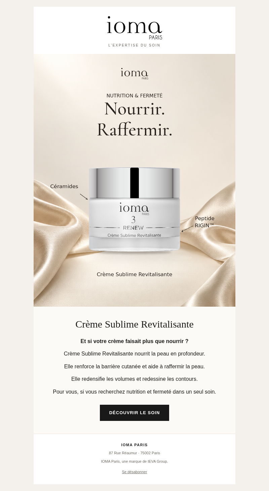
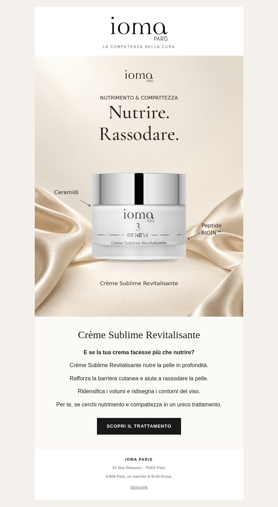

# Email Crème Sublime — version bénéfices

Version plus développée du 12 octobre 2026 : cinq phrases, 48 mots commerciaux en français, 47 en italien. Accroche de curiosité, trois phrases sur les bénéfices documentés et une conclusion expliquant à quelles attentes le soin répond. Le texte se réorganise naturellement sur mobile.

Le visuel reste le feed déjà exporté dans `posts/2026-10-08-creme-sublime-radar-v2/`, copié sans retouche, recadrage ou recompression. Cette version enrichit un email existant ; elle ne constitue pas une nouvelle recherche de tendances. Les exports précédents restent archivés.

| Langue | Objet | Préheader |
| --- | --- | --- |
| Français | Et si votre routine devenait sublime ? | Un soin expert pour nourrir votre peau et renforcer sa barrière cutanée. |
| Italien | E se il tuo rituale diventasse sublime? | Un trattamento per nutrire la pelle e rafforzare la barriera cutanea. |

`email.html` est le template Klaviyo avec des images hébergées et un lien de désinscription dynamique. `email.eml` est une ébauche avec images incorporées, destinataire à renseigner ; sa désinscription est une demande par email au contact IOMA. Aucun envoi n’a été effectué. `email-preview.png` montre le rendu de l’email. Les deux versions conservent une seule CTA.

## Français

## Italiano

