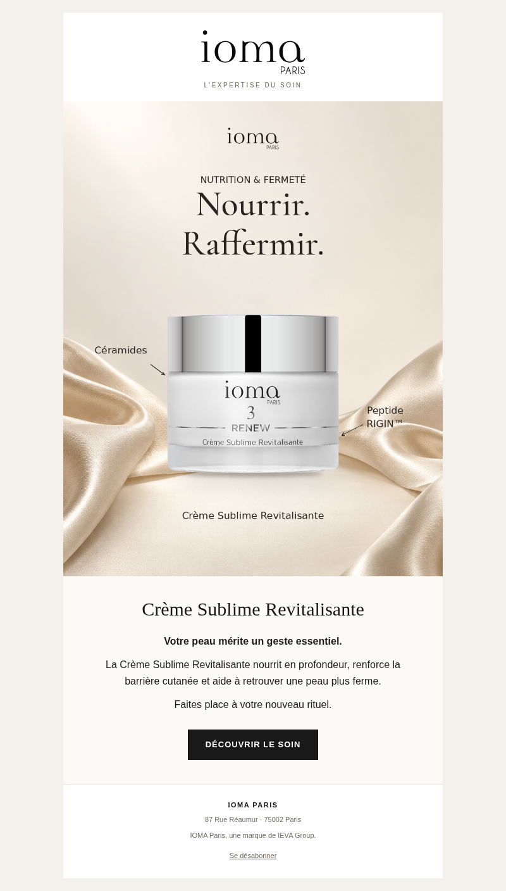
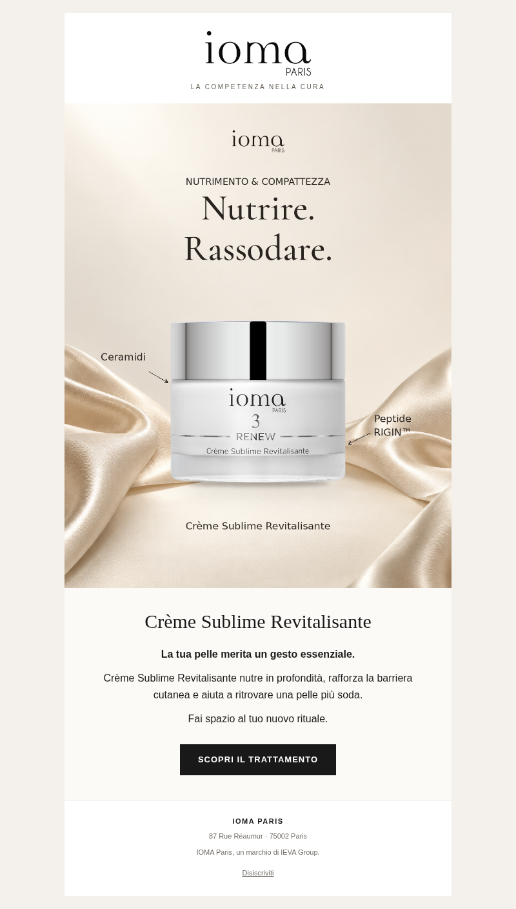

# Email coordinata — Crème Sublime Revitalisante

Email francese e italiana aggiunte il 12 ottobre 2026 alla creatività già esportata in `posts/2026-10-08-creme-sublime-radar-v2/`. Il feed è copiato byte per byte. Questo esempio estende una campagna esistente: non presenta le fonti dell’8 ottobre come una nuova ricerca del 12 ottobre.

| Lingua | Oggetto | Preheader |
| --- | --- | --- |
| Francese | Et si votre routine devenait sublime ? | Un soin expert pour nourrir votre peau et renforcer sa barrière cutanée. |
| Italiano | E se il tuo rituale diventasse sublime? | Un trattamento per nutrire la pelle e rafforzare la barriera cutanea. |

- `fr/email.eml` e `it/email.eml`: bozze con lo stesso feed e il logo incorporati, da aprire nel client email; destinatario vuoto. Nessuna email è stata inviata. La disiscrizione della bozza è via email al contatto IOMA.
- `fr/email.html` e `it/email.html`: template responsive da importare in Klaviyo. Puntano agli asset pubblicati in questa cartella; Klaviyo risolve il link di disiscrizione per destinatario. L’oggetto è nel titolo HTML e il preheader è nascosto.
- `feed.png`: immagine originale della campagna precedente, senza ritocchi, ritagli o ricompressione.
- `email-logo.png`: logo IOMA originale.
- `email-preview.png`: anteprima dell’email renderizzata per questa dimostrazione; l’email vera rimane HTML e testo modificabile.

Il messaggio ha 31 parole commerciali in ciascuna lingua, una sola CTA e benefici presenti nel catalogo. Gli esempi email forniti guidano lo stile; testimonianze e dati di altri prodotti non sono ripresi.

## Anteprima francese

## Anteprima italiana

