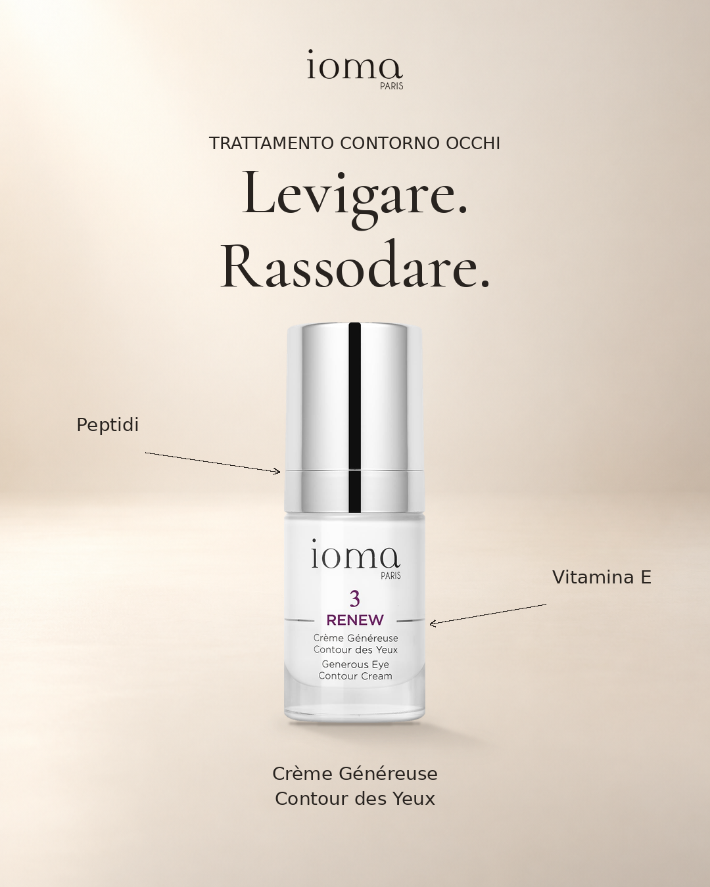

# IOMA · Crème Généreuse Contour des Yeux

Campagna del 17 ottobre 2026, in francese e italiano. Packshot e logo originali IOMA.

| Lingua | Feed 1080×1350 | Story 1080×1920 | Banner 300×250 | PowerPoint | Email HTML | Bozza EML |
|---|---|---|---|---|---|---|
| Français | [Feed](fr/feed.png) | [Story](fr/story.png) | [Banner](fr/banner.png) | [4 slide](fr/presentazione.pptx) | [Klaviyo](fr/email.html) | [EML](fr/email.eml) |
| Italiano | [Feed](it/feed.png) | [Story](it/story.png) | [Banner](it/banner.png) | [4 slide](it/presentazione.pptx) | [Klaviyo](it/email.html) | [EML](it/email.eml) |

## Copy social e oggetti email

### Français

Un soin dédié au contour des yeux.

Crème Généreuse Contour des Yeux lisse les rides et les ridules de cette zone délicate.

Découvrez le soin sur ioma-paris.com.

#IOMAParis #ContourDesYeux #SoinVisage

**Objet:** Et si tout commençait par le regard ?

**Preheader:** Un soin ciblé pour lisser les rides et ridules du contour des yeux.

### Italiano

Un trattamento dedicato al contorno occhi.

Crème Généreuse Contour des Yeux leviga rughe e linee sottili di questa zona delicata.

Scopri il trattamento su ioma-paris.com.

#IOMAParis #ContornoOcchi #Skincare

**Oggetto:** E se tutto iniziasse dallo sguardo?

**Preheader:** Un trattamento mirato per levigare rughe e linee sottili del contorno occhi.

## Fondali e ombre

L’agente ora usa fondali avorio e perla con spazio uniforme per titoli e ingredienti,
piano d’appoggio conservato in ogni formato e ombre derivate dalla sagoma del prodotto.
L’ombra di contatto resta aderente alla base; quella proiettata segue la luce in alto
a sinistra e sfuma verso destra. La campagna qui usa il fondale avorio.

## Verifica e utilizzo

Sei PNG, otto slide e le email desktop/mobile verificati visivamente. Gli hash dei
14 file e le osservazioni sono nel [registro di qualità](../../research/2026-10-17-contour-yeux-quality.json)
e nel database locale. I 38 test esistenti e i 5 nuovi controlli sono passati.
I benefici e gli ingredienti sono verificati nella [scheda IOMA](https://ioma-paris.com/products/creme-genereuse-contour-des-yeux).

Il PowerPoint contiene fonti datate, link cliccabili e dati Google Trends del
10–16 ottobre 2026, con filtro editoriale dichiarato. I valori TOP sono indici relativi,
non volumi. Le crescite confrontano il 3–9 ottobre. I dati originali sono
[archiviati qui](../../research/google-trends/2026-10-10_2026-10-16/).
La comunicazione dei concorrenti guida gli spunti editoriali, non i claim IOMA.

L’HTML usa gli asset HTTPS di questa cartella sul ramo principale `main`
ed è predisposto per Klaviyo; il servizio
risolve la disiscrizione per ciascun destinatario. La bozza EML incorpora esattamente
il PNG del feed e il logo, si apre offline e ha il destinatario vuoto.
Le email non sono state inviate e i contenuti non sono stati pubblicati sui social.
Per scaricare un file da GitHub, aprirlo e usare **Download raw file**.
